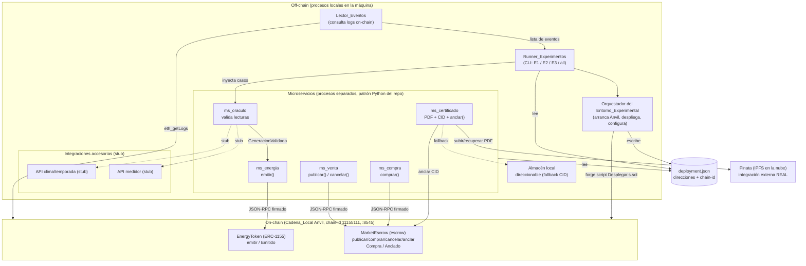

# Design Document

## Overview

Este diseño cubre el MVP de validación experimental de la arquitectura blockchain de Voltera (punto 07, Entrega 4). El objetivo es ejecutar, contra una cadena **local** (Anvil), los tres experimentos del cuaderno y producir evidencia reproducible con veredicto PASS/FAIL:

- **E1 — Integridad del Oracle** (R2): ninguna lectura inválida llega a emitir tokens.
- **E2 — Integridad del certificado off-chain** (R3): toda alteración de un certificado PDF se detecta contra el CID anclado on-chain, sin falsos positivos.
- **E3 — Tokenización sin doble venta** (R4): el escrow garantiza exactamente una venta por oferta bajo compras concurrentes y conserva los kWh.

Para que los experimentos corran de extremo a extremo, el MVP añade los cinco microservicios que tocan la cadena (`ms_oraculo`, `ms_energia`, `ms_venta`, `ms_compra`, `ms_certificado`, R5), un `Lector_Eventos` que recolecta la evidencia on-chain (R6) y un `Runner_Experimentos` que orquesta y reporta (R7). La preparación del entorno (arrancar Anvil, desplegar los contratos existentes y configurar el mercado) la cubre el orquestador del `Entorno_Experimental` (R1).

### Objetivos del MVP

- Reutilizar los contratos ya existentes y probados (`EnergyToken`, `MarketEscrow`) y el script `blockchain/script/Desplegar.s.sol` sin modificarlos.
- Alinear el software nuevo con el estilo del repositorio: microservicios Python con el patrón `main.py` / `config.py` / `health.py`, y un runner Python inspirado en `experiments/runner/` pero **sin AWS**.
- Mantener nítida la frontera **on-chain / off-chain**: lo que el experimento mide es comportamiento real (validación del oráculo, integridad del contenido, atomicidad del escrow); lo accesorio (APIs de medidor, clima) puede ser stub.
- Producir un `Reporte_Resultados` reproducible: mismos parámetros ⇒ mismo veredicto.

### No objetivos (fuera de alcance del MVP)

- Sin Docker, kind ni kubectl (Anvil corre con el binario nativo).
- Sin KEDA, sin OpenTelemetry/Grafana, sin bus de eventos de dominio pesado (Kafka/SQS), sin checkpoints ni deduplicación entre reinicios del lector.
- Alcance **funcional**, no de carga: valida el comportamiento de la arquitectura, no su capacidad máxima.

## Architecture

### Componentes locales



### Frontera on-chain / off-chain

- **On-chain (real, inmutable):** la emisión de tokens (`EnergyToken.emitir` → `Emitido`), la atomicidad de la venta (`MarketEscrow.comprar` → `Compra`) y el anclaje del CID (`MarketEscrow.anclar` → `Anclado`). Aquí vive la garantía que E1/E3 ejercitan (modelo custodial: solo la plataforma firma) y la huella de integridad que E2 ancla.
- **Off-chain (real en lo medido, stub en lo accesorio):** la lógica de validación de `ms_oraculo` (real y determinista), la generación/verificación del PDF por contenido en `ms_certificado` (real, con Pinata real + fallback local), la orquestación y medición del runner. Las APIs de medidor y clima son stub.

### Flujo por experimento

**E1 (Integridad del Oracle):** Runner inyecta 200 inválidas + 200 válidas → `ms_oraculo` acepta/rechaza (lógica real) → cada aceptada emite `GeneracionValidada` → `ms_energia` llama `emitir` → `Emitido` on-chain. El Runner mide latencia `LecturaRegistrada`→`GeneracionValidada` y, vía `Lector_Eventos`, confirma 0 `Emitido` originados por lecturas inválidas.

**E2 (Integridad del certificado):** Runner parte de certificados íntegros ya anclados → produce 50 alterados (3 formas) → `ms_certificado` recupera el contenido por CID (Pinata o fallback) y recalcula el identificador por contenido → veredicto ÍNTEGRO/ALTERADO/ERROR. El Runner mide latencia de verificación y cuenta detecciones y falsos positivos.

**E3 (Tokenización sin doble venta):** Runner publica 1 oferta Activa → lanza 100 compras concurrentes (`ms_compra`) → el escrow confirma 1 y revierte el resto → repite ×10 ofertas. El Runner, vía `Lector_Eventos`, cuenta `Compra` por oferta (debe ser 1), suma gas por operación y verifica conservación de kWh (tokenizados == validados).

## Technology Decisions and Rationale

### Lenguaje de los microservicios y del runner: Python 3.14

Se elige Python para alinear con el repositorio: los microservicios existentes en `services/` siguen el patrón `main.py` / `config.py` / `health.py` y hay una lib común `libs/voltera_common`. El runner existente `experiments/runner/` también es Python. Reutilizar el estilo reduce fricción y permite compartir utilidades (modelo de `Criterion`/`ExperimentResult`, salida JSON+Markdown del reporte). **(R5, R7)**

### Comunicación con la cadena: cliente JSON-RPC `web3.py`

Los microservicios y el `Lector_Eventos` hablan con Anvil por JSON-RPC usando **`web3.py`** (la biblioteca estándar y mantenida de Ethereum para Python). Justificación:

- Soporta codificación/decodificación de ABI, firma local de transacciones (`eth_account`), lectura de recibos (`eth_getTransactionReceipt`) y consulta de logs (`eth_getLogs`), que es exactamente lo que requieren R5 (escritura firmada), R4/R7 (gas por recibo) y R6 (eventos).
- Es pura Python, no requiere Docker ni servicios adicionales; encaja con el MVP nativo.

**Obtención del ABI desde Foundry.** Los contratos ya se compilan con Foundry y los artefactos quedan en `blockchain/out/<Contrato>.sol/<Contrato>.json` (p. ej. `blockchain/out/EnergyToken.sol/EnergyToken.json` y `blockchain/out/MarketEscrow.sol/MarketEscrow.json`). El cliente de cadena carga el campo `abi` de ese JSON en tiempo de arranque; no se duplica ni se transcribe el ABI a mano. Un helper común (`chain_client`) resuelve la ruta de `out/` relativa al repo y expone objetos `Contract` tipados por su ABI.

### Firma de transacciones con la llave de la plataforma (modelo custodial)

Ambos contratos restringen la escritura a `plataforma` (modificador `soloPlataforma`). En el MVP la plataforma es la **cuenta 0 de Anvil**, cuya llave privada de prueba es pública y conocida. Los microservicios firman localmente con `eth_account` usando esa llave, leída de la variable de entorno `PLATAFORMA_PRIVATE_KEY` (nunca hardcodeada en el repo). Como todos firman con la misma cuenta (custodial), el vendedor y el comprador viajan como **parámetros** (`publicar(vendedor,...)`, `comprar(ofertaId, comprador)`), no como `msg.sender`, tal como exigen los contratos. Tras enviar, el microservicio **espera la confirmación on-chain hasta 30 s**; si se revierte o no confirma, registra el error, **no reintenta** y deja la operación off-chain sin marcar como completada. **(R5.9, R5.10)**

### Medición de gas y latencias

- **Gas (R4.7, R7.3):** se lee `gasUsed` del recibo de transacción (`eth_getTransactionReceipt`) de cada operación on-chain individual. Es el valor real consumido por esa transacción.
- **Latencias (R2.7, R2.8, R3.9, R3.10):** se miden off-chain con un reloj monotónico (`time.monotonic`) en el runner:
  - E1: desde que el runner marca `LecturaRegistrada` hasta que recibe `GeneracionValidada` de `ms_oraculo`.
  - E2: desde que `ms_certificado` recibe la solicitud de verificación hasta que emite el veredicto.
  - El p95 se calcula sobre la muestra completa del experimento.

### Las 100 compras concurrentes (E3)

Para ejercitar la atomicidad del escrow (R4.1–R4.2), el runner lanza **100 envíos concurrentes** de `comprar(ofertaId, comprador_i)` sobre la misma oferta Activa. Como todas las transacciones las firma la **misma** cuenta (la plataforma), comparten el espacio de nonce; para evitar colisiones de nonce en el cliente, el `ms_compra` asigna nonces secuenciales explícitos (consulta `eth_getTransactionCount` una vez y reparte `nonce, nonce+1, ...`) y envía las transacciones en paralelo (hilos / `concurrent.futures`). Anvil las ordena en bloques: la primera que toca el estado deja la oferta `Vendida` y **todas las demás revierten** con `OfertaNoDisponible`. El runner no depende del orden: solo verifica que exactamente 1 confirmó (1 evento `Compra`) y las otras 99 revirtieron. El escenario se repite sobre 10 ofertas distintas. **(R4.1–R4.5)**

> Nota: el comportamiento "segunda compra concurrente revierte con `OfertaNoDisponible`" ya está cubierto por los 16 tests Foundry existentes; E3 lo valida de extremo a extremo con medición de gas y conservación de kWh.

### Transporte entre microservicios: HTTP simple (síncrono)

Para el MVP se elige **HTTP síncrono** entre el runner y los microservicios, y entre microservicios, en lugar de una cola/bus. Justificación:

- Respeta "servicios reales" (R5): cada microservicio es un proceso separado con su propio endpoint, no una función importada.
- Es lo más simple que cumple el MVP: el repo ya usa `http.server` de la stdlib para `health.py`; se extiende ese mismo patrón a endpoints de dominio, sin introducir Kafka/SQS ni un broker.
- Los eventos de dominio `LecturaRegistrada`/`GeneracionValidada` se modelan como **mensajes HTTP** (petición/respuesta) entre runner → `ms_oraculo` → `ms_energia`, con un identificador de lectura que los correlaciona; no hay bus de dominio (coherente con R6: sin bus, sin checkpoints).
- La medición de latencia extremo a extremo es directa con llamadas síncronas.

Cada microservicio mantiene su `GET /healthz` (patrón `health.py`) para que el orquestador confirme readiness antes de inyectar casos.

## Components and Interfaces

### Orquestador del Entorno_Experimental (R1)

Responsabilidad: arrancar Anvil, desplegar los contratos, configurar el mercado y publicar el archivo de despliegue.

- Arranca `anvil --chain-id 11155111 --port 8545` como proceso hijo; hace *polling* de `eth_chainId`/`eth_blockNumber` hasta responder, con tope de **30 s** (R1.1).
- Si el puerto 8545 ya está en uso o se agota el timeout: **no despliega** y registra un error con la causa (R1.2).
- Despliega con el script Foundry existente: `forge script script/Desplegar.s.sol --rpc-url http://localhost:8545 --private-key $PLATAFORMA_PRIVATE_KEY --broadcast` (cwd `blockchain/`). El script ya ejecuta `configurarMercado` dentro del `run()` (R1.3, R1.4).
- Extrae las direcciones desplegadas (de la salida del script / `broadcast/`) y escribe `deployment.json` (R1.3).
- Si un despliegue falla: detiene, deja los experimentos sin habilitar y registra el contrato afectado y el motivo (R1.6).
- Usa el binario nativo de Foundry 1.9.0, sin Docker (R1.5). El README del entorno documenta Foundry/Node 24/Python 3.14 e indica que Docker no es requerido (R1.7).

### ms_oraculo (R2, R5.1)

- `POST /lecturas` recibe una lectura; aplica validación **real y determinista** (misma entrada ⇒ mismo veredicto, R2.2) de las tres categorías de invalidez:
  - *valor alterado*: la lectura no es consistente con la referencia esperada del medidor (stub de medidor/clima provee la referencia; la decisión es lógica real).
  - *medidor desconocido*: el `medidorId` no está en el padrón conocido.
  - *lectura duplicada*: el `lecturaId` (o la tupla medidor+época) ya fue registrado en la corrida.
- Si es inválida: responde `{aceptada:false, motivo, categoria}` sin emitir (R2.3).
- Si es válida: responde `{aceptada:true}`, publica `GeneracionValidada` (llamada HTTP a `ms_energia`) y el flujo completa la emisión (R2.4, R5.1).
- Integraciones de medidor/clima vía stub con respuestas predefinidas (R5.8).

### ms_energia (R5.2)

- `POST /emisiones` recibe una generación validada y llama `EnergyToken.emitir(a, id, kwh, precio, lecturaId)` **exactamente una vez por `lecturaId`** (idempotencia por lectura). Firma con la llave de la plataforma y espera confirmación ≤30 s (R5.9).

### ms_venta (R5.3)

- `POST /ofertas` → `MarketEscrow.publicar(vendedor, id, kwh)`; devuelve `ofertaId`.
- `POST /ofertas/{id}/cancelar` → `MarketEscrow.cancelar(ofertaId)`.

### ms_compra (R5.4)

- `POST /compras` con `{ofertaId, comprador}` → `MarketEscrow.comprar(ofertaId, comprador)`. Expone además un modo de disparo concurrente que el runner usa en E3 (envío en paralelo con nonces explícitos). Devuelve éxito/reversión con el hash de tx.

### ms_certificado (R3, R5.5, R5.6, R5.11)

- `POST /certificados` con `{ofertaId, datosCompra}`: genera el PDF, lo **sube a Pinata** (API real) obteniendo el CID, y **solo si el guardado tuvo éxito** llama `MarketEscrow.anclar(ofertaId, cid)` (R5.5, R5.6, R5.11).
- `POST /verificaciones` con `{ofertaId}`: lee el CID anclado on-chain (`certificado(ofertaId)`), recupera el contenido por CID desde Pinata (o fallback) y compara el identificador por contenido. Devuelve `{veredicto: ÍNTEGRO|ALTERADO|ERROR, ...}` (R3.5, R3.7, R3.11, R3.12).

**Integración con Pinata.**
- Subir: `POST https://api.pinata.cloud/pinning/pinFileToIPFS` (autenticación por JWT en `Authorization: Bearer`), respuesta con `IpfsHash` (= CID).
- Recuperar: `GET https://gateway.pinata.cloud/ipfs/{cid}`.
- Credenciales por entorno: `PINATA_JWT` (o API key/secret). Nunca en el repo ni en el reporte (R3.4).
- **Fallback local (R3.3):** si no hay internet/credenciales, se usa un almacén de contenido direccionable local que calcula el **CIDv1** del contenido con el mismo algoritmo que IPFS (`sha2-256`, multihash, codec `raw`) y guarda el blob indexado por ese CID. Así el CID sigue siendo *determinado por el contenido* y la verificación por contenido es equivalente a la de Pinata.

### Lector_Eventos (R6)

- Lee `Emitido` (EnergyToken), `Compra` y `Anclado` (MarketEscrow) con `eth_getLogs` sobre las direcciones de `deployment.json` (R6.1).
- Asocia cada evento al `runId` y registra `transactionHash` y `blockNumber` (R6.2).
- Al terminar la corrida entrega al runner la lista de eventos observados (R6.3).
- Sin bus, sin checkpoints, sin dedup entre reinicios. Si la cadena no responde 30 s, registra error de indisponibilidad (R6.4).

### Runner_Experimentos (R7)

- CLI: `python -m runner_blockchain e1 | e2 | e3 | all [opciones]` (inspirado en `experiments/runner/cli.py`).
- Selección inválida (distinta de E1/E2/E3): rechaza la corrida sin ejecutar nada y registra el error (R7.7).
- Orquesta inyección, ejecución, recolección (vía `Lector_Eventos`) y escribe el `Reporte_Resultados` por experimento (R7.1, R7.6).
- Reproducibilidad: mismos parámetros ⇒ mismo veredicto (R7.4); los generadores de casos usan **semilla fija** derivada de `runId`/parámetros.

### Archivo de despliegue `deployment.json`

```json
{
  "chainId": 11155111,
  "rpcUrl": "http://localhost:8545",
  "plataforma": "0xf39Fd6e51aad88F6F4ce6aB8827279cffFb92266",
  "contratos": {
    "EnergyToken": "0x…",
    "MarketEscrow": "0x…"
  },
  "herramientas": { "foundry": "1.9.0" },
  "desplegadoEn": "2026-10-01T12:00:00Z"
}
```
Lo escribe el orquestador (R1.3) y lo leen el runner y los microservicios para resolver direcciones y RPC.

### Formato del Reporte_Resultados

Un directorio por corrida con `report.json` y `report.md` (reutilizando el modelo `ExperimentResult`/`Criterion` del runner existente). Campos principales:

- Cabecera de corrida: `runId`, `inicio`, `fin`, `cantidades` inyectadas, `repeticiones`, `contratos` (direcciones), `herramientas` (Foundry/Anvil) (R7.2).
- Por experimento: `veredicto` PASS/FAIL, `criterios` (con esperado/observado), `metricas` (tasa de rechazo, p95, detección, falsos positivos, dobles ventas, conservación kWh, gas por operación).
- Evidencia on-chain: lista de eventos `Emitido`/`Compra`/`Anclado` con `transactionHash` y `blockNumber`; frontera on/off-chain explícita (R7.3).
- FAIL marca la métrica incumplida con su valor y umbral (R7.5). Las credenciales de Pinata nunca aparecen (R3.4).

## Data Models

### Lectura (E1)

```
Lectura {
  lecturaId: str            # identificador único de la lectura
  medidorId: str
  epoca: int                # p. ej. 202610
  fuente: str               # "solar", ...
  kwh: int
  precio: int               # precio por kWh
  participante: address     # a quién se emite
}

VeredictoLectura {
  lecturaId: str
  aceptada: bool
  categoria: "valor_alterado" | "medidor_desconocido" | "lectura_duplicada" | null
  motivo: str | null
}
```
Un caso inválido lleva `categoria` != null; uno válido lleva `aceptada=true`.

### Oferta (E3) — refleja el struct del contrato

```
Oferta {
  ofertaId: int
  vendedor: address
  comprador: address        # 0x0 mientras no se venda
  id: uint256               # token id (fuente+época)
  kwh: int
  estado: "Inexistente" | "Activa" | "Vendida" | "Cancelada"
}
```

### Certificado (E2)

```
Certificado {
  ofertaId: int
  pdfBytes: bytes           # contenido del PDF
  cid: str                  # CID por contenido (Pinata o fallback local)
  ancladoEn: { txHash, blockNumber } | null
}

Verificacion {
  ofertaId: int
  veredicto: "INTEGRO" | "ALTERADO" | "ERROR"
  formaAlteracion: "byte" | "metadatos" | "reemplazo" | null
  latenciaMs: int
}
```

### Registro de evento on-chain (R6)

```
EventoOnChain {
  runId: str
  tipo: "Emitido" | "Compra" | "Anclado"
  args: { ... }             # campos decodificados del evento
  transactionHash: str
  blockNumber: int
  gasUsed: int | null       # del recibo, cuando aplica (E3)
}
```

### Estructura del reporte (R7)

```
Reporte {
  runId: str
  inicio: str; fin: str
  parametros: { cantidades, repeticiones, contratos, herramientas }
  experimentos: [
    {
      experimento: "E1" | "E2" | "E3"
      veredicto: "PASS" | "FAIL"
      metricas: { ... }       # p95, tasaRechazo, deteccion, falsosPositivos, doblesVentas, conservacionKwh, gasPorOperacion
      criterios: [ { id, titulo, estado, esperado, observado } ]
      evidencia: [ EventoOnChain ]
    }
  ]
}
```

## Correctness Properties

*Una propiedad es una característica o comportamiento que debe cumplirse en todas las ejecuciones válidas del sistema: una afirmación formal de lo que el sistema debe hacer. Las propiedades son el puente entre las especificaciones legibles por humanos y las garantías de corrección verificables por máquina.*

Estas propiedades capturan los invariantes centrales que los tres experimentos ejercitan. Son universalmente cuantificadas y se validan con property-based testing (ver Testing Strategy). Las métricas de latencia (p95) y la orquestación del entorno son de rendimiento/integración y no se expresan como propiedades (ver Testing Strategy).

### Property 1: Toda lectura inválida se rechaza sin emitir tokens

*Para toda* lectura inválida (de cualquiera de las tres categorías: valor alterado, medidor desconocido, lectura duplicada), `ms_oraculo` la rechaza y el flujo no origina ninguna emisión de tokens para ese `lecturaId` (ningún evento `Emitido`).

**Validates: Requirements 2.3, 2.5, 2.6**

### Property 2: Toda lectura válida se acepta y origina exactamente una emisión

*Para toda* lectura válida, `ms_oraculo` la acepta y el flujo completa la emisión produciendo exactamente un evento `GeneracionValidada` y exactamente un evento `Emitido` para ese `lecturaId`.

**Validates: Requirements 2.4, 5.2**

### Property 3: La validación del oráculo es determinista

*Para toda* lectura, validarla dos veces con `ms_oraculo` produce el mismo veredicto (misma decisión de aceptación/rechazo y misma categoría cuando se rechaza).

**Validates: Requirements 2.2**

### Property 4: La emisión es idempotente por lectura

*Para toda* secuencia de generaciones validadas, incluso si un mismo `lecturaId` se entrega más de una vez, `ms_energia` produce exactamente un evento `Emitido` por `lecturaId`.

**Validates: Requirements 5.2**

### Property 5: El CID está determinado por el contenido

*Para todo* contenido de certificado, el CID calculado por el almacén de contenido direccionable (Pinata o el fallback local equivalente) es función del contenido: el mismo contenido produce siempre el mismo CID y dos contenidos distintos producen CIDs distintos (salvo colisión criptográfica), y el fallback local produce el mismo CID que IPFS para el mismo contenido.

**Validates: Requirements 3.2, 3.3**

### Property 6: Round-trip de integridad del certificado

*Para todo* certificado PDF íntegro cuyo CID se ancla on-chain, verificar el contenido original contra el CID anclado devuelve ÍNTEGRO, y verificar cualquier versión alterada (cambio de un byte, cambio de metadatos o reemplazo completo) contra ese mismo CID devuelve ALTERADO.

**Validates: Requirements 3.5, 3.6, 3.7, 3.8**

### Property 7: Verificación con CID ausente o contenido no recuperable nunca es ÍNTEGRO

*Para toda* verificación en la que el CID anclado no existe para la compra, o el contenido no puede recuperarse desde Pinata/IPFS, el resultado es ERROR de verificación y nunca se contabiliza como ÍNTEGRO ni como falso positivo.

**Validates: Requirements 3.11, 3.12**

### Property 8: Exactamente una venta por oferta bajo concurrencia

*Para toda* oferta en estado Activa y *para todo* número k de compras concurrentes con 2 ≤ k ≤ 100 sobre esa oferta, exactamente una compra se confirma (exactamente un evento `Compra` y la oferta queda Vendida) y las k−1 restantes se revierten con `OfertaNoDisponible`.

**Validates: Requirements 4.2, 4.4, 4.5**

### Property 9: Comprar una oferta no Activa revierte sin efectos

*Para toda* oferta que no esté en estado Activa (Vendida, Cancelada o Inexistente), cualquier intento de compra se revierte con `OfertaNoDisponible` sin modificar el estado de la oferta ni los balances de kWh.

**Validates: Requirements 4.3**

### Property 10: Conservación de kWh

*Para toda* corrida de E3, la suma total de kWh tokenizados (vía eventos `Emitido`) es exactamente igual a la suma total de kWh validados, con diferencia absoluta igual a 0 (conservación del 100%).

**Validates: Requirements 4.6**

### Property 11: Todo evento observado queda trazado a la corrida

*Para todo* evento (`Emitido`, `Compra`, `Anclado`) que el `Lector_Eventos` observa, el registro entregado al runner contiene el `runId`, el `transactionHash` y el `blockNumber` del evento.

**Validates: Requirements 6.2, 6.3**

### Property 12: El veredicto PASS/FAIL es correcto y reproducible

*Para todo* vector de métricas de un experimento, el runner asigna PASS si y solo si todas las métricas cumplen su umbral, y en caso FAIL registra la(s) métrica(s) incumplida(s) con su valor y umbral; y *para todo* conjunto de parámetros y semilla, dos corridas con los mismos parámetros producen el mismo veredicto por experimento.

**Validates: Requirements 7.4, 7.5**

## Error Handling

- **Indisponibilidad de la cadena (R1.2, R2.9, R6.4):** el orquestador aborta el arranque si Anvil no responde en 30 s o el puerto está ocupado, sin desplegar; durante E1, si la cadena o `ms_oraculo` no responden 30 s, el runner aborta E1 con FAIL por indisponibilidad; el `Lector_Eventos` registra error de lectura si la cadena no responde en 30 s.
- **Reversión / no confirmación de transacción (R5.9, R5.10):** cada microservicio espera confirmación ≤30 s; si la tx revierte o no confirma, registra el error con el identificador de la operación, **no reintenta** y deja la operación off-chain sin marcar como completada.
- **Fallo del despliegue (R1.6):** se detiene el arranque, se dejan los experimentos sin habilitar y se registra el contrato afectado y el motivo.
- **Pinata caído / sin credenciales (R3.3):** `ms_certificado` cae al almacén local de contenido direccionable equivalente (mismo CID por contenido).
- **Guardado en Pinata falla al anclar (R5.11):** `ms_certificado` no llama `anclar` para esa compra y registra el error con la compra afectada.
- **CID inexistente / contenido no recuperable / Pinata sin respuesta en verificación (R3.11, R3.12):** veredicto ERROR; no cuenta como ÍNTEGRO ni como falso positivo.
- **Selección de experimento inválida (R7.7):** el runner rechaza la corrida sin ejecutar nada y registra la selección inválida.

## Security

- **Credenciales de Pinata (R3.4):** se proveen por variable de entorno (`PINATA_JWT` o API key/secret), nunca escritas en el repositorio ni incluidas en el `Reporte_Resultados`. El `.gitignore` del proyecto excluye archivos de entorno locales.
- **Llave de la plataforma:** la llave privada de la cuenta 0 de Anvil es de prueba y de uso **solo local**; se lee de `PLATAFORMA_PRIVATE_KEY` y no se persiste en el reporte. Es aceptable que sea conocida porque la cadena es local y efímera; no debe reutilizarse en ninguna red real.
- **Frontera de confianza:** solo los cinco microservicios firman con la llave de la plataforma; los contratos refuerzan esto con el modificador `soloPlataforma` (R5.7).

## Testing Strategy

El MVP combina pruebas basadas en propiedades (para los invariantes universales), pruebas de ejemplo/unitarias (para casos concretos y condiciones de error) y pruebas de integración/smoke (para la orquestación del entorno y las métricas de rendimiento).

### Property-based testing (invariantes)

PBT es apropiado aquí porque los invariantes centrales son afirmaciones universales sobre espacios de entrada amplios: lecturas arbitrarias (E1), contenidos de PDF arbitrarios y formas de alteración (E2), número y orden de compras concurrentes y cantidades de kWh (E3). Se usa **Hypothesis** (biblioteca estándar de PBT para Python); no se implementa PBT desde cero.

- Cada propiedad de la sección Correctness Properties se implementa con **una** prueba basada en propiedades.
- Cada prueba corre un **mínimo de 100 iteraciones**.
- Cada prueba se etiqueta con un comentario que referencia la propiedad del diseño, con el formato:
  **Feature: experimentos-blockchain-local, Property {número}: {texto de la propiedad}**
- Para propiedades que tocan la cadena (8, 9, 10), las pruebas corren contra una Anvil local efímera; para abaratar iteraciones donde aplique (p. ej. verificar la lógica de `ms_compra`/veredicto) se usan mocks del cliente de cadena, reservando la validación extremo a extremo para la corrida real del experimento.
- Los generadores cubren explícitamente los casos borde (R3.11/R3.12 CID ausente o contenido no recuperable; R5.10 reversión/timeout) como entradas que los generadores producen.

Cobertura de propiedades: P1–P4 (E1 / ms_oraculo / ms_energia), P5–P7 (E2 / ms_certificado / CID), P8–P10 (E3 / escrow), P11 (Lector_Eventos), P12 (runner).

### Pruebas de ejemplo / unitarias

- Construcción del dataset de E1: aseverar 200 inválidas (≥50 por categoría) + 200 válidas (R2.1).
- Conteo agregado de E3: exactamente 1 `Compra` por oferta y 0 dobles ventas en las 10 repeticiones (R4.4, R4.5); gas registrado por operación (R4.7).
- Rechazo de selección inválida en el CLI del runner (R7.7).
- Restricción de escritura por `soloPlataforma` verificada por los 16 tests Foundry existentes (R5.7).

### Pruebas de integración / smoke

- Arranque de Anvil con readiness ≤30 s; `deployment.json` bien formado; manejo de puerto ocupado, timeout y fallo de despliegue (R1.1–R1.6).
- Latencias de rendimiento como umbrales de integración medidos en la corrida real: p95 E1 ≤ 10 s (R2.8) y p95 verificación E2 ≤ 3 s (R3.10).
- Integración real con Pinata (subir/recuperar) cuando hay credenciales; con fallback local cuando no las hay.

## Traceability

| Requisito | Componentes / Decisiones de diseño que lo cubren |
|---|---|
| **R1** Preparar cadena y desplegar | Orquestador del Entorno_Experimental; Anvil nativo; `forge script Desplegar.s.sol`; `deployment.json`; manejo de puerto/timeout/fallo; README de herramientas |
| **R2** E1 Integridad del Oracle | `ms_oraculo` (validación real y determinista); dataset 200+200; flujo `GeneracionValidada`→`Emitido`; medición p95; evaluación PASS/FAIL; Properties 1–3 |
| **R3** E2 Integridad del certificado | `ms_certificado` (PDF, Pinata real + fallback local, anclar, verificar por CID); credenciales por env; veredicto ÍNTEGRO/ALTERADO/ERROR; Properties 5–7 |
| **R4** E3 Sin doble venta | `ms_compra` (100 compras concurrentes con nonces explícitos); `MarketEscrow` (atomicidad); gas por recibo; conservación de kWh; Properties 8–10 |
| **R5** Microservicios que tocan la cadena | `ms_oraculo/energia/venta/compra/certificado` como procesos HTTP; `web3.py` + ABI de Foundry `out/`; firma custodial con `PLATAFORMA_PRIVATE_KEY`; confirmación ≤30 s sin reintento; stubs solo accesorios; Properties 2, 4 |
| **R6** Evidencia de eventos on-chain | `Lector_Eventos` (`eth_getLogs` sobre direcciones de `deployment.json`); trazado por `runId`/txHash/blockNumber; sin bus ni checkpoints; Property 11 |
| **R7** Reproducibilidad y reporte | `Runner_Experimentos` (CLI E1/E2/E3/all); `Reporte_Resultados` JSON+Markdown; parámetros, métricas y evidencia; semilla fija; FAIL con métrica/umbral; rechazo de selección inválida; Property 12 |
